<div align="center">



<br/>

[](https://github.com/IvanMurzak/Unreal-MCP/releases) [](https://www.fab.com/listings/d1d5cbef-0aaa-4516-a309-92f39dee0c33) [](https://www.npmjs.com/package/unreal-mcp-cli) [](https://www.unrealengine.com/)<br/>[](https://github.com/IvanMurzak/Unreal-MCP/actions/workflows/release.yml) [](https://ai-game.dev) [](https://discord.gg/cfbdMZX99G) [](../LICENSE) [](https://stand-with-ukraine.pp.ua)

  <p>
    <a href="https://claude.ai/download"></a>&nbsp;&nbsp;
    <a href="https://openai.com/index/introducing-codex/"></a>&nbsp;&nbsp;
    <a href="https://www.cursor.com/"></a>&nbsp;&nbsp;
    <a href="https://code.visualstudio.com/docs/copilot/overview"></a>&nbsp;&nbsp;
    <a href="https://gemini.google.com/"></a>&nbsp;&nbsp;
    <a href="https://antigravity.google/"></a>&nbsp;&nbsp;
    <a href="https://code.visualstudio.com/"></a>&nbsp;&nbsp;
    <a href="https://www.jetbrains.com/rider/"></a>&nbsp;&nbsp;
    <a href="https://visualstudio.microsoft.com/"></a>&nbsp;&nbsp;
    <a href="https://opencode.ai/"></a>&nbsp;&nbsp;
    <a href="https://github.com/cline/cline"></a>&nbsp;&nbsp;
    <a href="https://github.com/Kilo-Org/kilocode"></a>
  </p>

  <b>[English](../README.md) | [中文](README.zh-CN.md) | [日本語](README.ja.md) | [Español](README.es.md) | [فارسی](README.fa.md) | [हिन्दी](README.hi.md) | [العربية](README.ar.md)</b>

</div>

**Unreal MCP** (AI Game Developer para Unreal) conecta cualquier agente de IA compatible con MCP al **Editor de Unreal**. Pide lo que quieras con palabras sencillas y el agente crea actores, edita niveles, crea y compila Blueprints, edita y compila C++, gestiona assets y comprueba su trabajo con capturas de pantalla. Es el hermano de [Unity-MCP](https://github.com/IvanMurzak/Unity-MCP) y [Godot-MCP](https://github.com/IvanMurzak/Godot-MCP) para Unreal, y usa el mismo backend en la nube ([ai-game.dev](https://ai-game.dev)) o tu propio [GameDev-MCP-Server](https://github.com/IvanMurzak/GameDev-MCP-Server).

<p align="center">
  
</p>

El editor de Unreal está escrito en C++, así que el host MCP de .NET se ejecuta a su lado como un pequeño **sidecar** (`unreal-mcp-bridge`) que el plugin inicia, vigila y reinicia por ti. Detalles del diseño: [docs/ARCHITECTURE.md](ARCHITECTURE.md).

**Estado:** [última release](https://github.com/IvanMurzak/Unreal-MCP/releases/latest) (el plugin, el sidecar y la CLI comparten una versión) · Unreal Engine 5.5–5.8 · el sidecar se compila para Windows x64, macOS (Intel y Apple silicon) y Linux x64 · cada release se prueba en Windows (UE 5.5–5.8) y macOS (UE 5.7, 5.8) · disponible en [Fab](https://www.fab.com/listings/d1d5cbef-0aaa-4516-a309-92f39dee0c33) y en [GitHub Releases](https://github.com/IvanMurzak/Unreal-MCP/releases).

## Características

✅ **Escritura de C++** — genera clases, edita el código y compila; los errores vuelven con archivo, línea y severidad\
✅ **Blueprints** — crea, edita y compila, con errores estructurados que el agente puede corregir\
✅ **Capa de datos RQL** — consulta y cambia actores, assets y niveles con un solo lenguaje ([RQL](rql.md))\
✅ **Feedback visual** — capturas del viewport, de la vista de juego, de cámara y de actores aislados\
✅ **Python** — ejecuta Python del editor con toda la API `unreal`\
✅ **Fab** — busca en Fab, lista tu biblioteca, añade contenido que posees\
✅ **Extensiones** — GAS, Niagara, PCG, Landscape, Control Rig, Enhanced Input\
✅ **Tus propias herramientas** — añade herramientas, prompts y recursos desde cualquier plugin ([guía](EXTENSIONS.md))\
✅ **Modo runtime** — actívalo para controlar un juego en ejecución ([docs/RUNTIME.md](RUNTIME.es.md))\
✅ **Nube o local** — `ai-game.dev` listo para usar, o un `gamedev-mcp-server` autoalojado

**Cobertura:** el agente puede hacer prácticamente todo lo que tú haces en el Editor de Unreal. Grupos de herramientas: la capa de datos RQL, Blueprints, código C++, capturas de pantalla, Fab, la consola, Python del editor y la lista de herramientas, más las extensiones. Todas las herramientas: [docs/TOOLS.md](TOOLS.es.md).

**Eficiencia:** las herramientas son compactas por diseño, así que el agente necesita menos llamadas y menos tokens por tarea, y trabaja más rápido y más barato. Para la capa de datos RQL esto está medido en la evaluación propia de RQL (un mundo de juego de prueba, mismas tareas, modelo y evaluador): RQL necesitó unas 9–18× menos llamadas a herramientas y 17–19× menos tokens por tarea que las herramientas de reflexión convencionales de buscar / volcar a JSON / asignar ([resultados](https://github.com/IvanMurzak/RQL/blob/main/RESULTS.md#33-rql-vs-conventional-reflection-tools)).

### Qué puedes pedir

| Pide a tu agente | Herramientas que usa |
| --- | --- |
| "Añade una clase de actor `AHealthPickup` en C++, compílala y corrige los errores" | `source-create-class`, `source-update`, `source-compile` |
| "Haz un Blueprint de puerta que se abra al solaparse, compílalo y colócalo en el nivel" | `blueprint-*` |
| "Cuenta los árboles de este nivel y sube 1 m todas las luces puntuales" | `rql-query`, `rql-mutate` |
| "Haz una captura desde la cámara del jugador y revisa la iluminación" | `screenshot-*` |
| "Busca un pack de rocas gratuito en Fab y añádelo al proyecto" | `fab-search`, `fab-add` |
| "Renombra en lote los assets seleccionados con un script de Python" | `python-execute` |

**C++ es un ciclo de primera clase.** `source-compile` compila con Live Coding cuando está activo y, si no, con UnrealBuildTool, y devuelve cada diagnóstico con su archivo, línea y severidad, así que el agente corrige errores sin leer el log de compilación. Avisa cuando un cambio necesita una compilación completa y reiniciar el editor (clases nuevas, declaraciones `UCLASS` / `UPROPERTY` / `UFUNCTION` cambiadas). Las operaciones con archivos se quedan dentro de `<Project>/Source/`. Desde una terminal, `unreal-mcp-cli compile` imprime diagnósticos `file:line:col` sin editor.

**RQL se aprende del propio editor:** `rql-schema` lista cada fuente, tipo y miembro, y la skill `unreal-rql` enseña la sintaxis con recetas (`unreal-mcp-cli setup-skills` la escribe para tu agente).

## Requisitos

- **Unreal Engine 5.5 – 5.8** (el pipeline de release valida cada una).
- **Un proyecto C++**, porque el plugin se distribuye como código fuente y Unreal compila sus módulos para tu proyecto con la toolchain de C++ de tu plataforma. Un proyecto solo de Blueprints pasa a ser C++ en un paso: en el editor, **Tools → New C++ Class…** y crea cualquier clase. Para un proyecto nuevo, `unreal-mcp-cli create-project ./MyGame` genera uno mínimo en C++. La build de Fab no necesita un proyecto C++: el Epic Games Launcher la instala precompilada.
- **Sin instalar .NET.** El host MCP es un programa .NET autocontenido (`unreal-mcp-bridge`) incluido en el plugin para tu plataforma; el plugin lo inicia y lo reinicia. (La build de Fab no contiene ejecutables: su botón **Get bridge** abre la página de la release y extraes el bridge en la carpeta del bridge del plugin una sola vez.) Solo compilar el bridge desde el código fuente requiere el SDK de .NET 9.
- **Node.js 22.14+**, solo para `unreal-mcp-cli` (un paquete npm; 22.14 es su versión mínima de Node).
- **Windows o macOS** (cada release se prueba en ambos). **Linux x64:** el sidecar se compila y se publica, pero ninguna prueba de release se ejecuta en Linux.

## Inicio rápido

**1. Instala el plugin**, de una de estas formas:

- **[Fab](https://www.fab.com/listings/d1d5cbef-0aaa-4516-a309-92f39dee0c33)** (sin terminal): añade **AI Game Developer** a tu motor, actívalo en **Edit → Plugins** y abre tu proyecto.
- **Dos comandos** (Node.js 22.14+):

```bash
npx unreal-mcp-cli install-plugin ./MyGame   # plugin + bundled bridge into MyGame/Plugins
npx unreal-mcp-cli open ./MyGame             # build if needed and open the editor
```

**2. Conecta, en el editor:** abre **Tools → AI Game Developer**.

- Solo instalación desde Fab: instala una vez el sidecar `unreal-mcp-bridge` (la build de Fab no lleva ejecutables): pulsa **Get bridge** para abrir la página de la release, extrae el zip de tu plataforma en la carpeta que muestra **Open bridge folder** y pulsa **Connect**.
- **Cloud** (por defecto): pulsa **Authorize** y aprueba el inicio de sesión en tu navegador. **Local**: cambia a **Custom** y pulsa **Start** junto a **MCP server**; el editor descarga el `gamedev-mcp-server` con checksum verificado (con una instalación de Fab, instala ese servidor a mano: el log indica la descarga).
- En **AI agent**, elige el tuyo (Claude Code, Cursor, Codex, …) y pulsa **Configure**.

**3. Pide a tu agente:** *"Crea tres cubos en fila y una luz puntual encima de ellos, y luego toma una captura de pantalla."*

¿Local o Cloud? Ambos modos tienen soporte completo y puedes cambiar más tarde. **Cloud es el modo por defecto** porque no necesita abrir puertos y evita conflictos de puertos con otros programas; la conexión es gratuita. **Local** funciona sin cuenta ni acceso a internet, para equipos sin conexión o aislados (air-gapped).

| | **Local** | **Cloud** |
| --- | --- | --- |
| Cuenta | ninguna | inicio de sesión en ai-game.dev |
| Servidor MCP | `gamedev-mcp-server` en tu equipo, iniciado por el editor o por tu agente | relay de ai-game.dev |
| Tráfico | se queda en `localhost` | pasa por ai-game.dev ([qué registra](#what-the-cloud-relay-sees)) |
| Autenticación | ninguna en loopback, o un token compartido (un flag) | OAuth o una clave por proyecto |
| Ideal para | trabajo sin conexión o aislado, CI, proyectos privados | sin puertos abiertos ni conflictos de puertos; una cuenta para varios proyectos y equipos |

<details>
<summary><b>Todo desde la terminal</b> (CLI: Cloud, Local, autenticación por token)</summary>

<p align="center">
  
</p>

**Cloud** (el modo por defecto del plugin):

```bash
npm install -g unreal-mcp-cli                       # or: npx unreal-mcp-cli@latest <command>

unreal-mcp-cli install-plugin ./MyGame              # copy the plugin (with its bridge) into MyGame/Plugins
unreal-mcp-cli login                                # sign in to ai-game.dev once per machine
unreal-mcp-cli setup-mcp claude-code -p ./MyGame    # write the agent's MCP config
unreal-mcp-cli open ./MyGame                        # build if needed and open the editor
```

**Local** (sin cuenta):

```bash
npm install -g unreal-mcp-cli
unreal-mcp-cli install-plugin ./MyGame
unreal-mcp-cli configure -p ./MyGame --mode Custom                 # plugin: local server
unreal-mcp-cli setup-mcp claude-code -p ./MyGame --transport stdio # agent starts it
unreal-mcp-cli open ./MyGame
```

`setup-mcp --transport stdio` descarga en el proyecto la release del `gamedev-mcp-server` con checksum verificado y apunta el agente a ella. Ambos lados usan el mismo puerto por proyecto en `localhost`.

**Activar la autenticación por token (local):** añade los flags a la línea `configure` y vuelve a ejecutar `setup-mcp`; a partir de ahí el plugin y el servidor exigen el secreto.

```bash
unreal-mcp-cli configure -p ./MyGame --mode Custom --auth required --token <secret>
```

Por qué en local no hay autenticación por defecto: el servidor solo escucha en loopback y rechaza peticiones de orígenes de navegador no locales, así que solo los programas de tu propio equipo pueden llegar a él. Usa un token cuando no confíes en todos los programas o usuarios de ese equipo. El secreto se guarda en el `.env` del proyecto (que `configure` añade a gitignore) y en el archivo de configuración del agente, así que mantén ese archivo fuera del control de versiones.

</details>

<a id="what-the-cloud-relay-sees"></a>**Qué ve el relay en la nube.** En modo Cloud, las llamadas a herramientas pasan por el relay MCP de ai-game.dev. El relay no guarda estado: enruta las llamadas entre tu cliente de IA y el editor sin inspeccionar ni almacenar su contenido, y no recoge tus conversaciones, código fuente, archivos del proyecto, assets ni datos de escena. Registra metadatos de las peticiones (dirección IP del cliente, marca de tiempo y duración, código de estado y ruta de la petición, nombre de la herramienta, tamaño de la petición y de la respuesta) y metadatos de eventos MCP (tipo de evento, tiempos, estado, identificadores de sesión, el nombre de la herramienta, prompt o recurso, y los detalles de errores). Los logs de peticiones y los eventos MCP se usan principalmente dentro de una ventana móvil de 90 días; la política no garantiza el borrado automático a una edad fija. Detalles: [Política de privacidad](https://ai-game.dev/legal/privacy).

`install-plugin` descarga la release firmada del código fuente del plugin que coincide con la versión de la CLI.

Otras formas de instalar:

- **Zip en formato Fab**: además del [anuncio en Fab](https://www.fab.com/listings/d1d5cbef-0aaa-4516-a309-92f39dee0c33), cada release de GitHub incluye una build en formato Fab (`unreal-mcp-plugin-fab-<version>.zip`) sin ejecutables; con cualquiera de las dos, el botón **Get bridge** de la ventana te guía para instalar el sidecar una sola vez.
- **Manual**: copia [`UnrealMCP/`](../UnrealMCP/) en `<YourProject>/Plugins/UnrealMCP/`. Una copia del código fuente no incluye el sidecar: ejecuta `unreal-mcp-cli bootstrap-local` o define `UNREAL_MCP_BRIDGE_PATH`.

Actualización (`unreal-mcp-cli update`), modos de conexión, variables de entorno y solución de problemas: [docs/CONFIGURATION.md](CONFIGURATION.es.md).

### Configuración del agente

`unreal-mcp-cli setup-mcp <agent> -p ./MyGame` escribe la configuración por ti (`setup-mcp --list` muestra todos los agentes compatibles). Lo que escribe:

<details>
<summary><b>Claude Code</b>: <code>.mcp.json</code></summary>

```bash
unreal-mcp-cli setup-mcp claude-code -p ./MyGame
```

```json
{
  "mcpServers": {
    "unreal-mcp": {
      "type": "http",
      "url": "https://ai-game.dev/mcp/p/<pin>",
      "headers": { "Authorization": "Bearer agd_pk_…" }
    }
  }
}
```

El `<pin>` enruta al editor de este proyecto. La cabecera es la clave de este proyecto cuando el equipo tiene la sesión iniciada; `--oauth` escribe una configuración solo con URL y el agente inicia sesión por sí mismo. Con `--transport stdio` la entrada ejecuta el servidor local: `"command"` es `gamedev-mcp-server` en `<project>/Intermediate/UnrealMCP/server/`, y `"args"` fija `port=<port>`, `client-transport=stdio` y `authorization=none`.

</details>

<details>
<summary><b>Cursor</b>: <code>.cursor/mcp.json</code></summary>

```bash
unreal-mcp-cli setup-mcp cursor -p ./MyGame
```

La misma entrada `mcpServers` → `unreal-mcp` que en Claude Code: `"type": "http"` con la URL, o `"type": "stdio"` con `command` y `args` para el servidor local.

</details>

<details>
<summary><b>Codex</b>: <code>.codex/config.toml</code></summary>

```bash
unreal-mcp-cli setup-mcp codex -p ./MyGame
```

```toml
[mcp_servers.unreal-mcp]
enabled = true
url = "https://ai-game.dev/mcp/p/<pin>"
tool_timeout_sec = 300
startup_timeout_sec = 30
```

Con una clave de proyecto, la sección también lleva `http_headers` con la cabecera `Authorization`.

</details>

## Uso

Casi siempre basta con hablar con tu agente. La CLI también llama directamente a las mismas herramientas e inicia un editor headless cuando no hay ninguno en ejecución:

```bash
# Query the level with RQL
unreal-mcp-cli rql -p ./MyGame 'actors | where Label starts-with "Tree" | count'

# Change it: set / call goes to rql-mutate (add --dry-run to preview)
unreal-mcp-cli rql -p ./MyGame 'editor | call SpawnActor("PointLight")'

# Run editor Python
unreal-mcp-cli exec -p ./MyGame "unreal.SystemLibrary.get_engine_version()"

# List every tool with its inputs, build C++ without the editor, run Automation tests
unreal-mcp-cli tools -p ./MyGame
unreal-mcp-cli compile ./MyGame
unreal-mcp-cli test ./MyGame
```

Todos los comandos y opciones: [cli/docs/commands.md](../cli/docs/commands.md) o `unreal-mcp-cli commands`.

## Seguridad

- **Plugin ↔ sidecar:** el plugin escucha en un puerto TCP de loopback; el sidecar se conecta con un token de un solo uso enviado por stdin (nunca en la línea de comandos, nunca en los logs).
- **Servidor local:** `gamedev-mcp-server` escucha en loopback por defecto y responde `403` a una petición cuyo `Origin` no está permitido (defensa contra DNS rebinding). En loopback el plugin lo inicia sin autenticación salvo que elijas un token (`UNREAL_MCP_AUTH_OPTION`, `UNREAL_MCP_TOKEN`). Opciones del servidor: [hosting y autenticación](https://github.com/IvanMurzak/GameDev-MCP-Server/blob/main/docs/hosting.md).
- **Cloud:** el agente inicia sesión con OAuth o usa una clave por proyecto que puedes reemplazar con `setup-mcp --regenerate-key`. El relay no guarda estado ni almacena el contenido de las llamadas; registra metadatos de peticiones y de eventos MCP ([detalles](#what-the-cloud-relay-sees)).
- **Qué pueden hacer las herramientas:** editar archivos en `<Project>/Source/`, ejecutar comandos de consola y Python del editor, cambiar cualquier propiedad reflejada.
- **Controles sobre ellas:**
  - **Lista blanca** (límite estricto): `UNREAL_MCP_TOOLS` sirve solo las herramientas indicadas; cualquier otra no se lista ni se puede llamar.
  - **Ocultar** (suave): la casilla **Visible** de la ventana **MCP Tools** quita una herramienta de `tools/list`, pero un cliente que la llame por su nombre aún la ejecuta.
  - **Cambios acotados:** las herramientas de archivos C++ se quedan dentro de `<Project>/Source/`; una llamada a `rql-mutate` es todo o nada, un solo paso de deshacer, se puede previsualizar con `dry_run` y se rechaza por encima de 200 objetivos salvo que la llamada suba `max_targets` (hasta 1000); `python-execute` se detiene tras `timeout` (30 s por defecto); cada llamada a una herramienta tiene un límite de tiempo (`UNREAL_MCP_TOOL_TIMEOUT`, 5 min por defecto).
  - **No para la IA:** las herramientas de sistema (`ping`, generación de skills, `editor-quit`) no aparecen en `tools/list`, y `editor-quit` se niega salvo que coincida el nonce de la sesión de la CLI.
  - Detalles: [docs/TOOLS.md](TOOLS.es.md).
- **El modo runtime está desactivado por defecto:** un juego nunca se conecta por sí solo. Necesita el ajuste `bRuntimeMcpEnabled` (desactivado por defecto) y una llamada explícita a `Connect()`, solo acepta un host de loopback salvo que permitas uno remoto, y se rechaza en builds Shipping salvo que se compile dentro. Deja el plugin fuera de los juegos empaquetados con un `TargetDenyList` ([docs/RUNTIME.md](RUNTIME.es.md)).

## Extensiones

Las extensiones son plugins opcionales que amplían RQL; no añaden herramientas propias.

```bash
unreal-mcp-cli install-extension com.ivanmurzak.unreal-ai-gas ./MyGame
```

| Extensión | Añade | Requiere |
| --- | --- | --- |
| [AI&nbsp;ControlRig](../extensions/UnrealAIControlRig/README.md) | Rigs de animación procedural y su conexión a Anim Blueprints | `ControlRig`, `RigVM`, UE 5.7+ |
| [AI&nbsp;EnhancedInput](../extensions/UnrealAIEnhancedInput/README.md) | Acciones de entrada, contextos de mapeo, triggers y modificadores | `EnhancedInput`, UE 5.7+ |
| [AI&nbsp;GAS](../extensions/UnrealAIGAS/README.md) | Gameplay Effects, Blueprints de habilidades y conjuntos de atributos | `GameplayAbilities`, `EnhancedInput`, `GameplayTagsEditor`, UE 5.7+ |
| [AI&nbsp;Landscape](../extensions/UnrealAILandscape/README.md) | Paisajes, océanos, lagos y ríos | `Water`, UE 5.7+ |
| [AI&nbsp;Niagara](../extensions/UnrealAINiagara/README.md) | Sistemas, emisores, módulos y colisión de Niagara | `Niagara`, `ChaosNiagara`, UE 5.7+ |
| [AI&nbsp;PCG](../extensions/UnrealAIPCG/README.md) | Grafos PCG, volúmenes y dispersiones generadas | `PCG`, UE 5.7+ |

Las extensiones se compilan desde el código fuente en tu proyecto (la próxima vez que abras el editor, o al momento con `--build`); el instalador activa los plugins del motor que necesitan.

## Documentación

| Página | Qué contiene |
|---|---|
| [docs/TOOLS.md](TOOLS.es.md) | Todas las herramientas integradas y de sistema, extensiones, visibilidad por herramienta |
| [docs/rql.md](rql.md) | El lenguaje de consultas RQL: fuentes, miembros, mutaciones, pruebas de juego |
| [docs/CONFIGURATION.md](CONFIGURATION.es.md) | Primer arranque, actualización, variables de entorno, solución de problemas |
| [docs/EXTENSIONS.md](EXTENSIONS.md) | Escribe tus propios módulos RQL, herramientas, prompts y recursos |
| [docs/RUNTIME.md](RUNTIME.es.md) | Modo runtime (dentro del juego), sus controles de seguridad, cómo dejar el plugin fuera de los juegos publicados |
| [cli/docs/commands.md](../cli/docs/commands.md) | Referencia de comandos de `unreal-mcp-cli` y códigos de salida |
| [docs/ARCHITECTURE.md](ARCHITECTURE.md) | El diseño de referencia (IPC, registro, sidecar, UI, configuración) |
| [docs/RELEASING.md](RELEASING.md) | Mantenedores: releases, runners de CI, secretos |
| [docs/EXTENSION-MONOREPO.md](EXTENSION-MONOREPO.md) | Mantenedores: pruebas y releases de las extensiones |

## Estructura del repositorio

| Ruta | Qué es |
|---|---|
| [`UnrealMCP/`](../UnrealMCP/) | El plugin de Unreal (C++): `UnrealMcpRuntime`, `UnrealMcpRql`, `UnrealMcpEditor` |
| [`bridge/`](../bridge/) | `unreal-mcp-bridge`, el sidecar de .NET 9 |
| [`cli/`](../cli/) | `unreal-mcp-cli`, el paquete npm |
| [`extensions/`](../extensions/) | Seis extensiones de motor opcionales con sus propias releases |
| [`samples/`](../samples/) | Una plantilla de extensión de editor y un ejemplo de herramienta en runtime (dentro del juego) |

## Enlaces

- [ai-game.dev](https://ai-game.dev) · [Discord](https://discord.gg/cfbdMZX99G) · [Issues](https://github.com/IvanMurzak/Unreal-MCP/issues)
- Proyectos hermanos: [Unity-MCP](https://github.com/IvanMurzak/Unity-MCP) · [Godot-MCP](https://github.com/IvanMurzak/Godot-MCP)
- Piezas compartidas: [GameDev-MCP-Server](https://github.com/IvanMurzak/GameDev-MCP-Server) · [MCP-Plugin-dotnet](https://github.com/IvanMurzak/MCP-Plugin-dotnet) · [ReflectorNet](https://github.com/IvanMurzak/ReflectorNet)
- [Model Context Protocol](https://modelcontextprotocol.io/)

## Licencia

**Gratis para desarrolladores de juegos, juegos comerciales incluidos.** Unreal MCP es [Apache-2.0](../LICENSE) © Ivan Murzak. Dos componentes incluidos, RQL y Code-Exec, usan la licencia [PolyForm Shield 1.0.0](https://polyformproject.org/licenses/shield/1.0.0), que solo restringe a las empresas que crean herramientas de IA competidoras para el desarrollo de juegos; puedes usarlo todo para crear, publicar y vender tus juegos. Avisos: [`UnrealMCP/ThirdPartyNotices.txt`](../UnrealMCP/ThirdPartyNotices.txt).
